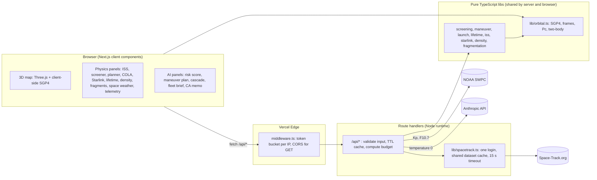

# SpaceDebris

Real-time space-debris collision-risk dashboard: SGP4 orbit propagation, conjunction screening, avoidance planning and launch COLA from public Space-Track data, with AI-written analysis layered on top of deterministic physics.

[](https://github.com/IQEmperor24/SpaceDebris/actions/workflows/ci.yml)

**Live:** [space-debris-two.vercel.app](https://space-debris-two.vercel.app) · **API docs:** [/docs](https://space-debris-two.vercel.app/docs) · **OpenAPI 3.1:** [/api/openapi](https://space-debris-two.vercel.app/api/openapi)

---

## What it is

SpaceDebris pulls a live sample of the public satellite catalog and conjunction messages from Space-Track.org and propagates every object with SGP4 in the browser and on the server. Every number in the physics panels is either public data or derived from it by deterministic orbital mechanics (screening, probability of collision, Clohessy-Wiltshire avoidance burns, launch collision avoidance, orbital lifetime), while the AI panels (risk score, maneuver plan, Kessler cascade, fleet brief, conjunction summaries) are Claude judgments at temperature 0, their scores and Δv / propellant figures included. Every physics assumption is stated on screen next to the number it affects.

> This is a planning and visualisation aid built on public TLE data. It is not flight software, it does not issue operational conjunction data messages, and it screens a sample of the catalog, not all of it.

## Live demo: what to click

1. **3D orbital map** (top left): click **600×** in the bottom-left time-warp control. Every debris dot is re-propagated with SGP4 at the simulated time; a LEO orbit sweeps past in about nine seconds. **LIVE** snaps back to now.
2. **ISS TOPO console**: live ISS state vector, ground track, and the next pass over NASA JSC in Houston (AOS, max elevation, LOS).
3. **Conjunction screener**: enter **ISS**, keep the 24 h window and press **RUN SCREEN**. You get the closest approaches within 50 km (up to 15, closest first) with TCA, miss distance, the RIC (radial / in-track / cross-track) separation, relative speed, probability of collision and the NASA ISS keep-out-box test. Then press **AI conjunction assessment** for a CARA-style memo with a GREEN / YELLOW / RED disposition.
4. **Avoidance planner**: take a screened close approach and see the burn trade space (lead time × Δv × prograde / retrograde), the recommended minimum-Δv burn that clears the decision threshold (Starlink's Pc 3e-7; NASA's 1e-4 red line when the target is the ISS), its propellant and burn time.
5. **Launch COLA**: pick a pad (SLC-40, LC-39A, SLC-4E, Starbase), a target orbit and a window. Every launch minute is graded GO / CAUTION / NO-GO and the next clear window is reported.
6. **Disposal compliance**: choose the Starlink-class preset at 550 km and compare solar-activity levels against the FCC 5-year line.
7. **System telemetry** (bottom of the page): watch the Space-Track request budget and the propagation tick percentiles, then run the in-browser SGP4 benchmark.

The jump bar under the header links to every panel, and **API docs →** opens the endpoint reference.

## Architecture



- **Pure libraries first.** All physics lives in side-effect-free modules under `lib/` (no React, no fetch), so the same code runs in route handlers, in the browser, and in the test suite.
- **Route handlers** validate and bound every input, keep a per-instance TTL cache, run compute-heavy work under a time budget (returning `truncated: true` rather than timing out), and never return an unhandled error.
- **Space-Track hygiene.** Concurrent cold requests share a single login and a single in-flight download per dataset (gp sample: 10 min; public CDMs: one pull of 100 rows, 60 s), with a 15 s timeout on every call. Every request is counted (per serverless instance, so a lower bound when several instances are warm) against the published 30/min and 300/hr limits and reported by `/api/health`.
- **Edge middleware** rate-limits `/api/*` per client IP in two tiers (general, plus a stricter bucket for Claude-backed and compute-heavy calls) and adds CORS headers to read-only responses.

## Features

### Core dashboard

- **3D orbital map**: about 2,000 objects drawn in a single `THREE.Points` call with a custom shader, log-scaled altitude, and LEO / MEO / GEO filters.
- **AI risk scorer**: Claude rates a satellite's collision risk (three 0–100 scores and a threat level) from its TLE and the surrounding debris density, and can draft a maneuver plan. Claude is prompted to estimate propellant with the Tsiolkovsky equation (1,000 kg, Isp 220 s); the code does not compute it, so the plan's Δv, propellant and miss figures are model estimates. The deterministic avoidance planner below is the computed counterpart.
- **Collision alert feed**: public conjunction data messages (CDMs) from Space-Track, summarised in plain English, with a Kessler-cascade scenario on demand.
- **Fleet intelligence**: catalog statistics, per-shell congestion status, the top threats and an executive brief.

### Orbital mechanics layer (deterministic, no AI)

- **Live SGP4 propagation and time warp**: the map re-propagates every object at the simulated time (LIVE, 1×, 10×, 60×, 600×).
- **Conjunction screening engine**: altitude-band prefilter, a 60 s coarse SGP4 sweep, then golden-section refinement of each local minimum to get TCA, miss distance, RIC separation and Pc. In the test suite, a denser 20 s brute-force search over a synthetic clone field finds no approach the sieve dropped.
- **ISS TOPO console**: 1 Hz ISS state, a ground track that handles the dateline, JSC pass predictions (10° mask), and public ISS CDMs graded against NASA's thresholds (RED at Pc ≥ 1e-4, YELLOW at ≥ 1e-5).
- **Fragmentation family tracker**: groups the sample by launch designator and attributes families to 11 catalogued breakups (Fengyun-1C, Cosmos 2251 / Iridium 33, Cosmos 1408 and others). A family is attributed only when both the designator and the object name match.
- **Orbital density profile**: altitude (50 km bins) and inclination (5° bins) histograms split into debris, payloads and rocket bodies, annotated with the 700–1,000 km band, the ISS and Starlink shells, and sun-synchronous inclinations.
- **Space weather and reentry watch**: NOAA planetary Kp and F10.7 solar flux, a drag-regime indicator, and the lowest-perigee objects with a first-order lifetime from the TLE mean-motion derivative.
- **Mission ops status bar**: UTC, day of year, GMST and Julian date, plus health LEDs for Space-Track and Claude.

### Operations layer

- **Starlink constellation monitor**: the public FCC shell table (Gen1 550/53°, 540/53.2°, 570/70°, 560/97.6°; Gen2 525/53°, 530/43°, 535/33°). Each Starlink object in the sample is classified as on-station, orbit raising/lowering, deorbiting or unassigned, and the panel counts the non-Starlink objects whose altitude range crosses each shell.
- **Avoidance burn planner**: Clohessy-Wiltshire (Hill) relative motion gives the displacement at TCA for an in-track burn applied τ before it. The planner sweeps burn lead × Δv × direction, recomputes the miss and Pc, and recommends the smallest Δv that brings Pc below the decision threshold (Starlink's published 3e-7 trigger, or NASA's 1e-4 red line for the ISS). It reports propellant and burn time for public-estimate vehicle presets, a Pc-versus-covariance sensitivity curve, and a flag when the encounter sits in the dilution region.
- **Launch COLA screening**: for every launch minute in a 60, 120 or 240 minute window, the vehicle is inserted into the target plane through the pad, coasts on two-body motion and is screened against the catalog sample. NO-GO below 5 km, CAUTION below 25 km.
- **Orbital lifetime and FCC 5-year disposal check**: exponential-atmosphere drag decay integrated to 120 km for ballistic-coefficient presets and three solar-activity levels, checked against the FCC 5-year rule (2022) and the legacy 25-year guideline.
- **Public API**: an OpenAPI 3.1 document and a `/docs` page generated from one source file, a token-bucket rate limit, and CORS for read-only endpoints.
- **Engineering rigor**: an in-repo test suite, GitHub Actions CI and this README.
- **System telemetry**: Space-Track request budget, orbit-propagation tick p50/p95 and frame budget, per-route API latency for the instrumented routes, and an on-demand in-browser SGP4 benchmark.

## How a conjunction screen works

`GET /api/screen?target=ISS&hours=24` runs an all-on-one screen of one target against the catalog sample:

1. **Prefilter.** Only objects whose perigee-apogee band (plus a margin) overlaps the target's are propagated, nearest altitude first, up to a candidate cap. Objects that never share an altitude shell with the target cannot approach it, so GEO and most MEO objects never reach the SGP4 loop for a LEO target.
2. **Coarse sweep.** The target is propagated once onto a 60 s grid, and each candidate is walked along it. Every local minimum of the sampled distance that falls under a gate is kept. The gate is the 50 km report threshold plus half a step at 16 km/s relative speed, so a true minimum under 50 km cannot hide between two samples. Grid points that provably sit above the gate are skipped.
3. **Refinement.** Each local minimum is bracketed and refined by golden-section search on the SGP4 distance, which gives TCA to well under a second.
4. **Geometry.** At TCA the relative position is expressed in the target's RIC frame, the relative velocity defines the encounter plane, and Pc is integrated over the hard-body disc in that plane.
5. **Report.** Only the closest approach per secondary is kept (co-orbital objects would otherwise produce one row per revolution). Rows are sorted by miss distance, graded, and returned with both ECI states at TCA so the avoidance planner can start from them.

A 24 h screen of the 2,000-object sample takes about a second on the server. Each request has a 20 s compute budget; if it runs out, the result says `truncated: true` rather than failing.

## Physics and assumptions

Each model is first-principles and deliberately simple. The caveats below are also printed in each panel.

| Model | What it does | Honest caveat |
| --- | --- | --- |
| **SGP4 / TLE** | `satellite.js` SGP4 on public two-line element sets, in the TEME frame. | TLEs are mean elements with no published covariance. Position error is of order a kilometre near epoch and grows with propagation time. The dashboard uses a sample of about 2,000 newest-epoch element sets, not the full catalog. |
| **RIC frame** | Radial (r̂), in-track (ĥ × r̂) and cross-track (ĥ = r × v normalised), right-handed, centred on the target. | Defined from the target's osculating state at TCA. |
| **Probability of collision** | 2-D encounter-plane integral of the combined position covariance over a hard-body disc (short-encounter, linear relative motion). | The covariance is assumed, not measured: σ = 0.3 / 1.0 / 0.3 km (R / I / C) per object, combined hard-body radius 20 m. Real conjunction assessment uses the covariance delivered with each CDM. Tests check the integral against closed-form isotropic and anisotropic results. |
| **Severity and ISS rules** | CRITICAL at Pc ≥ 1e-4 or miss < 1 km; HIGH at Pc ≥ 1e-5 or inside the ISS keep-out box (±2 km R × ±25 km I × ±25 km C); MEDIUM below 10 km. | Pc 1e-4 / 1e-5 (NASA's RED / YELLOW ISS thresholds) and the ±2 × 25 × 25 km keep-out box are public NASA figures; the 1 km and 10 km miss-distance tiers are this dashboard's own screening choices. All are applied here to TLE-derived numbers. |
| **Avoidance burns (CW)** | Hill / Clohessy-Wiltshire equations, linearised about a circular reference orbit; finite burns are modelled by superposition. The Pc 3e-7 decision threshold is SpaceX's published Starlink trigger (semiannual FCC report, July 2026; earlier filings said 1e-5). | CW is checked live against two-body propagation (universal variables, Vallado Algorithm 8) in the encounter plane; above 2 % error (or e > 0.005) the heat map is flagged indicative only, and every recommended burn is re-solved on two-body arcs with no linearisation before it is shown. J2, drag and SGP4-versus-two-body differences are ignored. Vehicle masses, Isp and thrust are public estimates. |
| **Orbital lifetime** | Circular-orbit decay da/dt = −√(μa)·ρ·B with the Vallado exponential atmosphere (Table 8-4) scaled by solar activity (0.5 / 1 / 2.5), integrated adaptively. | There is no solar cycle, attitude or eccentricity modelling. Anchor: a Starlink-class B of 0.04 m²/kg at 550 km decays in about 2.9 years at mean activity (about 1.2 y at high, 5.8 y at low), the same order as the commonly quoted figure of about five years. |
| **Launch COLA** | Insertion at T+9 min, 20° downrange in the plane through the pad, then a 20 min two-body coast screened every 30 s with refinement. | Much simpler than a real COLA: no ascent trajectory, no dispersions or covariance, and only the catalog sample. |
| **Reentry watch** | First-order decay from the TLE mean-motion derivative: da/dt = −(2/3)·a·(ṅ/n). | Optimistic, because real decay accelerates as perigee drops. |
| **Drag regime** | A heuristic from F10.7 bands, raised one level when Kp ≥ 5 (a NOAA G1+ storm). | An indicator for situational awareness, not a density model such as NRLMSISE-00 or JB2008. |

## Public API

Every endpoint is documented with parameters, example responses and `curl` commands at **[/docs](https://space-debris-two.vercel.app/docs)**, and as machine-readable OpenAPI 3.1 at **[/api/openapi](https://space-debris-two.vercel.app/api/openapi)**.

| Method | Path | What it returns | Engine |
| --- | --- | --- | --- |
| GET | `/api/debris` | Newest-epoch element-set sample, or one object by name / NORAD ID | deterministic |
| GET | `/api/screen?target=ISS&hours=24` | SGP4 conjunction screen of one target | deterministic |
| GET | `/api/iss` | ISS element set and public CDMs involving NORAD 25544 | deterministic |
| GET | `/api/cola?site=&orbit=&minutes=` | Launch COLA window screen | deterministic |
| GET | `/api/spaceweather` | Planetary Kp, F10.7 and the LEO drag regime | deterministic |
| GET | `/api/health` | Subsystem health and the live Space-Track request budget | deterministic |
| GET | `/api/openapi` | This API as an OpenAPI 3.1 document | static |
| GET | `/api/conjunctions` | Upcoming public CDMs with plain-English summaries | Claude |
| GET | `/api/fleet` | Fleet intelligence brief | Claude |
| POST | `/api/analyze` | AI collision-risk score for one satellite | Claude |
| POST | `/api/maneuver` | AI maneuver plan | Claude |
| POST | `/api/cascade` | AI Kessler-cascade scenario for one conjunction | Claude |
| POST | `/api/assess` | AI conjunction-assessment memo for a screening run | Claude |

Try it from a terminal:

```bash
curl -s "https://space-debris-two.vercel.app/api/screen?target=ISS&hours=24"
curl -s "https://space-debris-two.vercel.app/api/cola?site=slc-40&orbit=starlink-550&minutes=120"
curl -s "https://space-debris-two.vercel.app/api/health"
```

- **Rate limit:** two token buckets per client IP (IPv6: per /64). Every `/api/*` request spends from the general bucket (120-request burst, refilled at 2 per second = 120 per minute sustained). Expensive requests (every Claude-backed `POST`, `GET /api/screen`, `GET /api/cola`, and `/api/debris` with `search` or a `limit` other than 500 or 2000) must also pass a stricter bucket (20-request burst, 10 per minute sustained). Responses carry `X-RateLimit-Limit` and `X-RateLimit-Remaining` for the bucket that applies, plus `X-RateLimit-Tier`; over the limit you get `429` with `Retry-After`. Both are enforced per Edge instance, so best-effort rather than a global guarantee.
- **CORS:** `GET` endpoints allow any origin. The Claude-backed `POST` endpoints do not send CORS headers.
- **Caching:** every data route except `POST /api/analyze` keeps a per-instance cache (60 s to 15 min depending on the source), so repeated calls do not hit Space-Track, NOAA or Claude again; `/api/analyze` spends tokens on every call. The cache for each route is listed on [/docs](https://space-debris-two.vercel.app/docs).

## Engineering

- **TypeScript strict** throughout (`npm run typecheck`). Space-Track returns every field as a string; all parsing goes through `parseFloat` with `Number.isFinite` guards, so NaN, undefined and invalid dates never reach the UI.
- **Zero-dependency test suite.** `tests/*.test.ts` run on Node's built-in `node:test` runner with native TypeScript type stripping. A small resolver hook (`tests/alias-hooks.mjs`) maps the `@/` path alias so tests import exactly what the app imports. The suite covers:
  - SGP4 on an ISS-like synthetic element set (51.64°, about 420 km), checked against plausibility ranges rather than a reference ephemeris;
  - Pc against closed-form results;
  - two-body propagation against energy and angular-momentum conservation;
  - CW against two-body truth;
  - the screening sieve against a dense brute-force search;
  - the launch-window fast path against a per-minute reference;
  - the lifetime integrator against a fixed-step RK4 reference;
  - the Space-Track client (shared login, cache dedupe, 401 retry, timeout) against a mocked `fetch`;
  - the rate limiter with an injected clock.
- **No network in tests.** `tests/register.mjs` replaces `fetch` with a stub that throws, so the suite is deterministic and runs offline in CI.
- **CI** (`.github/workflows/ci.yml`) runs typecheck, then tests, then a production build on every push and pull request to `main`. It needs no secrets: the Anthropic client is created lazily and Space-Track is only called at request time.
- **Performance budgets** are asserted in the tests with generous CI margins:
  - SGP4 throughput (about 1 µs per call on a laptop);
  - a 24 h screen of 2,000 objects;
  - a 120-minute COLA window against 2,000 in-band objects;
  - a full avoidance trade space.
- **Observability.** `/api/health` reports Space-Track usage against its limits on every response, and the System Telemetry panel shows propagation tick percentiles and per-route latency for the instrumented routes, measured in the browser.

### Test-suite map

| Suite | What it proves |
| --- | --- |
| `orbital.test.ts` | Time systems, TLE parsing, SGP4 on the ISS, RIC orthonormality, look angles over JSC, Pc against analytic results, two-body conservation, launch-plane geometry |
| `screening.test.ts` | Co-orbital detection, prefilter decoys, severity rule, a 2,000-object performance run, truncation, a dense brute-force cross-check |
| `iss.test.ts` | JSC pass prediction (AOS/LOS on the 10° mask, in-progress passes), ground track and dateline split, CDM grading at exactly 1e-4 and 1e-5 |
| `maneuver.test.ts` | CW against two-body (impulsive and finite burns), trade-space completeness, the minimum-Δv rule, feasibility, time to TCA, Pc dilution |
| `launch.test.ts` | Insertion geometry for every pad × orbit, a constructed 3 km encounter between grid samples, fast path against reference, determinism, budget |
| `lifetime.test.ts` | Atmosphere table, hand-checked units, the 550 km anchor, monotone ladders, an RK4 convergence reference, runtime |
| `starlink.test.ts` | FCC shell table, inclusive matching tolerances, phase classification, crossing exposure, no NaN in a 2,000-row report |
| `spacetrack.test.ts` | One login for concurrent callers, shared caches, 401 re-login and retry, timeouts never cached, request accounting |
| `rateLimit.test.ts` | Burst, refill, sustained rate, LRU eviction, clock skew, configuration errors, Edge-safety |
| `spaceweather.test.ts`, `density.test.ts`, `fragmentation.test.ts` | Newest-row SWPC parsing, G-scale and drag regime, histogram bin edges, two-factor breakup attribution |

Run one suite with `node --experimental-strip-types --import ./tests/register.mjs --test tests/orbital.test.ts`.

## Design decisions

- **Deterministic first, AI second.** Everything the physics panels derive is computed: positions, misses, Pc, burns, lifetimes and COLA status. The AI panels (risk score, maneuver plan, cascade, fleet brief, conjunction summaries) are Claude judgments at temperature 0, and their scores and Δv / propellant figures are model estimates, not computed results. The screening memo is the one AI output limited to numbers it is handed, and it is told never to change them.
- **Show the assumption next to the number.** Assumed covariance, hard-body radius, vehicle presets and solar-activity factors are printed in each panel's footnote and returned in the API response (`assumptions`). Recomputing with different inputs changes the result in the open.
- **Sample, and say so.** Space-Track's request limits (30/min, 300/hr) and serverless time limits make a 2,000-object sample the honest choice for an interactive page. Every panel that aggregates the sample labels it as a sample.
- **Budgets instead of timeouts.** Heavy routes (screen, COLA) check a wall-clock budget inside their loops and return partial, flagged results. A slow request degrades instead of disappearing.
- **One shared physics layer.** Every feature reuses `lib/orbital.ts` (SGP4 guards, frames, Pc, two-body), so a correction there reaches all panels and is covered by one test file.

## Local development

Requirements: Node 22.6 or newer (`npm test` uses `--experimental-strip-types`, added in 22.6; `.nvmrc` selects the 22 line) and a free [Space-Track.org](https://www.space-track.org) account for live catalog data. NOAA SWPC needs no key.

Create `.env.local` in the repo root with these variables (values are your own; never commit this file):

| Variable | Used by |
| --- | --- |
| `SPACETRACK_USERNAME` | `lib/spacetrack.ts`: catalog and CDM data |
| `SPACETRACK_PASSWORD` | `lib/spacetrack.ts` |
| `ANTHROPIC_API_KEY` | `lib/anthropic.ts`: AI panels only; physics panels work without it |

```bash
npm install          # or: npm ci
npm run dev          # http://localhost:3000
npm test             # node:test suite, offline
npm run typecheck    # tsc --noEmit, strict
npm run build        # production build (no secrets needed)
```

Repository layout:

```text
app/            Next.js App Router: page, /docs, /api/* route handlers
components/     One self-contained client component per dashboard panel
lib/            Pure physics and data libraries (orbital, screening, maneuver, launch, ...)
middleware.ts   Edge rate limit + CORS for /api/*
tests/          node:test suites, fixtures and the @/ alias resolver
```

## Roadmap

- **Operator alerts**: subscribe to specific assets and get notified when a new conjunction involves them.
- **Continuous screening**: all-vs-all propagation on a schedule, with persistence and alerting, instead of on-demand screening of a sample.
- **Real covariance**: use the covariance and hard-body radius carried by CDMs wherever they are available, instead of assumed values.
- **Higher-fidelity dynamics**: J2 and drag in the avoidance model, and a density model driven by space weather for the lifetime and reentry estimates.
- **Full-catalog coverage**: screen against the whole public catalog rather than a 2,000-object sample.

## Author

Built by **Aayush**, a University of Waterloo Computer Science graduate, as a solo project that began at a 24-hour hackathon and grew into this production build.

Data: [Space-Track.org](https://www.space-track.org) (US Space Force, 18th Space Defense Squadron) and [NOAA Space Weather Prediction Center](https://www.swpc.noaa.gov). This project is independent and is not affiliated with or endorsed by NASA, SpaceX, the US Space Force or NOAA.
